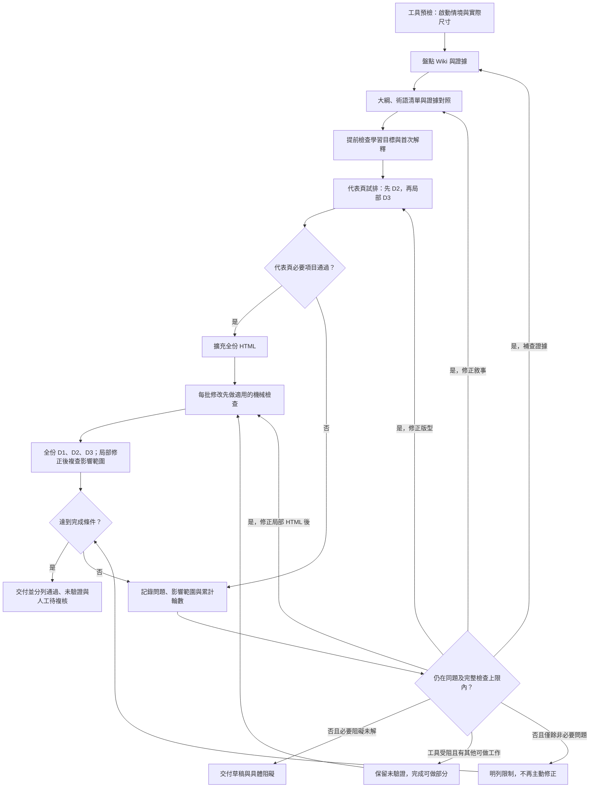

# HTML 簡報製作與修正 Loop

建立日期：2026-11-16（Asia/Taipei）。

最近修訂：2026-11-17（Asia/Taipei）。

主題：**從 Boom Bap 到 Rage：美國嘻哈曲風的演變與世代交替**。

文件狀態：首版簡報已於 2026-11-16 製作，實際結果與未驗證項目見[簡報檢查紀錄](presentations/boom-bap-to-rage/review-log.md)。本次依首輪問題修訂後續流程，未重新製作或驗收簡報；舊紀錄保留當時結果，不回寫成已通過新規格。閱讀或修改本文件本身不會啟動 loop，收到製作／修正簡報的指令後才執行。

## 1. 任務目標與適用規則

使用本專案目前的 Markdown Wiki，製作一份繁體中文 HTML 簡報，讓原本不熟悉嘻哈的人理解基本概念、聲音差異與歷史脈絡。

- 唯一已知的簡報內容要求是「讓不熟悉主題的人理解基本概念」。不自行增加固定報告時間、頁數、必須嵌入音樂或完整涵蓋所有分支的要求。
- 以適合新手的內容密度決定頁數；資料數量不直接決定投影片數量。
- 沿用 [AGENTS.md](AGENTS.md) 的來源、主張、查證、補查上限及紀錄規則。本文件補充簡報任務，不取代 Wiki 的長期維護規則。
- 歷史資訊取自實際讀取的 Wiki 與其證據；本文件的編排建議不是歷史來源。
- 一次任務內由同一個 Codex 依序執行撰寫、審閱與修正。這些是工作階段，不宣稱有獨立審稿人、多代理系統或背景排程。

## 2. 新手應能回答的問題

完成後，讀者應能僅依簡報回答以下四個問題。答案不要求背誦年份或藝人名單。

| 編號 | 學習問題 | 應達到的理解程度 |
| --- | --- | --- |
| L01 | Boom bap、Trap、Rage 大致是什麼？ | 能用白話描述各自的聲音線索；知道分類邊界可能有爭議。 |
| L02 | 這幾種聲音有哪些差異？ | 能從鼓組、取樣／合成器或人聲等已獲來源支持的面向比較，並理解所選作品的示範用途。 |
| L03 | 不同聲音在什麼條件下發展？ | 能以地域、製作方式、傳播渠道或社群的具體案例說明，並區分已知事實與作者解讀。 |
| L04 | 「演變與世代交替」在本簡報中指什麼？ | 理解審美、創作與傳播方式的變化，也知道不同風格可以並存、延續與融合。 |

先交代理解這些問題所需的基本用語。Beat、flow、取樣、808 等術語，只有在簡報實際使用時才加入，並在首次出現時用白話解釋；解釋也需有可追溯依據。

## 3. 敘事與教學原則

1. 以 Boom bap、南方嘻哈的必要背景、Trap、網路世代與 Rage 作為可調整的閱讀路線，沿用 Wiki 的實際證據決定各段比重。
2. 區分曲風、地域、平台與場景。Atlanta 不能概括整個南方，SoundCloud 世代也不能直接當成單一曲風。
3. 題目中的「從……到……」代表本次選取的時間與觀察範圍。用文字與圖像呈現並行及交叉關係，避免畫成風格依序消失的替代鏈。
4. 對「世代交替」給出本簡報的操作性說明，例如比較審美、創作或傳播方式。這是分析框架；涉及市場主導、普及程度或平台造成變化的主張，另需相應證據。
5. 每頁圍繞一個讀者需要理解的重點。每位人物、作品或事件都說明選用理由，避免只列名字。
6. 先讓讀者理解聲音與歷史，再保留必要的分類限制。與學習目標無關的器材規格、完整生平或命名爭論，可刪除或移至附錄。
7. 圖像、封面與時間軸應幫助解釋內容。日期上的相鄰、圖上的連線或同頁出現，不自動表示直接影響。

## 4. 開始執行前

收到製作簡報的指令後：

1. 閱讀 [README](README.md)、[索引](wiki/index.md)、[待查清單](logs/open_questions.md)、[近期操作紀錄](logs/ingestion_log.md)、[品質紀錄](logs/quality_report.md)及 [workflow](workflow.md)，再讀與本次簡報相關的實質條目與來源證據。
2. 搜尋是否已有同題簡報、大綱或 review log；有則沿用，先確認狀態，不另建平行版本。
3. 確認當次可用的檔案編輯、搜尋、網頁讀取與瀏覽器預覽能力。只記錄已確認的能力；缺少瀏覽器時，不宣稱已目視驗證。
4. 讀取現有 loop 狀態及問題輪數；中斷後接續原階段與未解問題，不把輪數歸零。
5. 頁數、視覺細節與作品選例由 Codex 在上述範圍內判斷，不逐項等待使用者確認。只有真正影響任務方向、且現有內容無法判斷的缺失資訊才詢問。
6. 先完成下列工具預檢，再安排正式試排；避免全部製作後才發現啟動或尺寸驗證不可用。

### 工具預檢與啟動情境

- 實際確認當次可用的預覽方式能載入 HTML。必要時可使用暫時本機 HTTP 預覽；只有實際載入成功才記為可用，不由命令已啟動推定瀏覽器可連線。
- 在 review log 先列出當次交付需要的驗證情境與理由，區分必驗與延伸驗證。直接以單檔開啟為交付情境時，本地檔案冷啟動需列為必驗；不要在受阻後改列選測以符合停止條件。
- 調整視窗後，先核對頁面實際回報的寬高，再開始該尺寸檢查；縮放與裝置像素比能取得時一併記錄，無法取得就明示未知。要求 1366×768 卻回報其他尺寸時，該次只記實際尺寸，不能計為要求尺寸已通過。
- 瀏覽器或某種協定受工具政策限制時，記錄限制並停止該途徑，不以換工具表面繞過政策。可繼續其他可執行的製作與檢查；必要情境仍未驗證時依第 8 節交付草稿／部分完成。
- 預檢發現的問題立即沿用或配置問題 ID，適用同題兩輪上限；不因它發生在完整檢查前而重設輪數。暫時預覽程序於任務結束後清理。

在 review log 分開記錄以下情境，不以其中一列代替其他列：

| 驗證情境 | 實際確認的內容 | 不能據此宣稱的結果 |
| --- | --- | --- |
| 本機 HTTP 啟動 | 透過本機網址重新載入 HTML、基本導覽與來源詳情。 | 不能證明直接開啟本地檔案成功。 |
| 本地檔案冷啟動 | 從尚未載入該檔案的分頁直接開啟 HTML，確認文字、導覽與來源詳情。 | 不能由 HTTP 成功或「無外部資源」的靜態檢查代證。 |
| 載入後無伺服器互動 | 停止預覽伺服器後，已載入頁面仍可翻頁及讀取來源。 | 不能證明無網路／無伺服器時重新啟動成功。 |

每列記錄必要性、實際方法／條件、日期、結果及依據。結果使用「通過／失敗／未驗證／不適用」；工具受阻列為未驗證並說明原因，不直接判定成品故障。若要宣稱完全離線冷啟動可用，還須在該啟動情境確認不依賴外部網路，不能只憑載入後互動通過。

## 5. 預計產物與目錄

執行時在 `presentations/boom-bap-to-rage/` 內建立或更新以下檔案。此處只是路徑規格，尚未建立的產物不寫成已完成連結。

| 檔案 | 用途 |
| --- | --- |
| `index.html` | 可直接以瀏覽器開啟的簡報，含導覽及可讀的參考來源入口。 |
| `outline.md` | 逐頁標題、教學重點、內容、例證、視覺安排及引用。 |
| `evidence-map.md` | 逐頁重要主張與 Wiki 主張、來源證據的對照。 |
| `review-log.md` | 執行階段、各輪檢查、問題、修正、複查與最後狀態。 |
| `assets/`、`asset-sources.md` | 有實際圖片或其他素材時才建立，記錄素材來源與用途。 |

固定學習目標 L01–L04，逐頁使用穩定 ID，例如 `slide-01`。調整順序時保留仍存在頁面的 ID，以便追蹤引用和問題。

## 6. Loop 的執行步驟

### A. 盤點 Wiki 與證據

- 將四個學習問題對照到相關 Wiki 頁面、主張及來源。
- 區分「已有支持」「保留限定可使用」「缺少必要證據」；優先處理會阻礙基本概念理解的缺口。
- 沿用來源原有性質：事實、當事人自述、作者觀點、綜合解讀或待查／有分歧。
- 來源數與 complete 狀態按執行時實際檔案重新確認。不得把數量達標解釋成所有主張均已交叉查證。

### B. 建立逐頁大綱與主張對照

每頁至少記錄：穩定 ID、標題、對應學習目標、希望讀者理解的一件事、必要解釋、人物／作品的選用理由及證據位置。

在 `evidence-map.md` 中，使用以下欄位：

| 頁面 ID | 簡報主張 | 主張性質 | Wiki 路徑＋C 編號 | 來源 ID＋E 定位 | 限制與採用表述 |
| --- | --- | --- | --- | --- | --- |

來源 E 定位需能沿來源筆記追溯到 raw 或原始資料。新寫的跨條目歷史分析如有獨立價值，先寫回適當 Wiki 頁面並建立穩定主張，再用於簡報。不要替尚未存在的主張編號填入假對照。

在 `outline.md` 另維護必要術語清單；頁面移動或用語增刪時同步更新：

| 術語 | 首次出現頁面 ID | 給新手的白話解釋 | Wiki 主張與來源 E 定位 | 處理狀態 |
| --- | --- | --- | --- | --- |

只列實際使用的術語，不為補齊名詞而增加教學負擔。解釋沒有支持時先回 A 補查並更新 Wiki，或刪除非必要用語，不用模型記憶填入技術定義。每位人物／作品也須在大綱寫出一句角色介紹與選用理由。

大綱完成後，先以其文字嘗試回答 L01–L04，逐題指明頁面及例證，再核對術語解釋、人物角色、作品用途與段落銜接。必要理解缺口在此先修正；此為提前執行的 AI 教學檢核，不能取代完成 HTML 後的 D1。範圍已明確時直接繼續試排，無需再要求使用者逐頁批准。

### C. 製作 HTML 初稿

**C1：先試排代表頁**

- 從正式大綱挑選少量代表頁，例如 2–3 頁，優先涵蓋最長標題、最多內容、表格或較複雜的來源呈現；一頁可涵蓋多種風險。這是試排數量建議，不是整份簡報的頁數要求。
- 沿用正式頁面 ID 與同一份 HTML，不另建平行簡報。已有簡報時，只對本次受影響或新引入的版型做必要試排，不從頭重做。
- 每批試排先執行適用的 D2 機械檢查，再進行 D3 的局部畫面與導覽檢查。先確認一般筆電尺寸可讀，再檢查較大投影比例；都須核對實際尺寸。
- 發現主文、來源標記或導覽放不下時，先刪減重複內容、調整排列或拆頁，再考慮縮小字體。修正及複查仍計入同一問題的兩輪上限。
- 代表頁在可驗證的必要條件下通過後，再擴充全份。代表頁通過不等於所有頁面通過；若工具受限，可繼續完成其他內容，但保留相應未驗證狀態，不宣稱試排已驗收。

**C2：擴充與維持一致性**

- 以適合投影的橫向簡報設計為預設，兼顧一般筆電視窗。使用清楚的繁體中文字體、對比、留白及可讀字級。
- 可依各段內容調整視覺氣氛，但維持一致的標題、導覽與來源呈現方式。
- 提供前後頁按鈕、鍵盤左右鍵及目前頁碼。互動控制須可辨識焦點，不能因翻頁使文字或來源無法閱讀。
- 優先採靜態 HTML，將必要 CSS 與 JavaScript 放在檔案內；本地素材採相對路徑。文字內容和基本導覽不依賴網路服務或外部 CDN。
- 外部音樂或影片可作延伸聆聽，採可辨識的作品名稱與連結。播放器或網路失效時，讀者仍能理解主文；嵌入音樂不是完成條件。
- 沒有實際聽取可確認版本的錄音時，將聲音描述歸於文字來源，不宣稱完成聆聽、音訊分析或精確時間碼定位。
- 各頁重要主張旁提供簡短來源標記，連到 HTML 中可讀的來源詳情；保留必要的作者觀點或證據限制。完整檔案路徑及 C／E 對照放在研究文件，不塞進主要教學版面。
- 在 HTML 的來源區提供實際採用的作者／機構、標題、可得日期與原始或實讀網址。文末清單不取代重要主張旁的標記。
- 圖片及封面記錄來源，未知欄位明示未知。只有裝飾用途的素材不能當作歷史證據。

### D. 分開完成三類檢查

D1、D2、D3 是檢查類型，不表示必須等全份 HTML 完成才檢查。大綱先做教學檢核，代表頁先做局部 D2／D3；每批相關新增或修改完成後，先跑適用的 D2，再核對受影響的 D1 內容，最後做 D3。可將同一目的的修改合為一批，不必每改一個字就重跑。全份完成後仍須完成一次涵蓋所有頁面的 D1–D3。

**D1：新手理解與歷史內容檢查**

- 僅依簡報中呈現的內容回答 L01–L04，逐題指出答案所在頁面；無法回答時記為缺口，不用模型背景知識補答案。
- 逐頁確認：術語首次出現有解釋、人物與作品有介紹、例證有用途、轉折有銜接。
- 核對 B 的術語清單與實際 HTML：首次出現位置、白話解釋及來源須一致；拆頁或換序後不可只更新大綱。
- 確認讀者能比較聲音差異，並分辨地域、平台、曲風與人物。
- 核對重要主張與引用是否相符，特別檢查起源、首次、影響、普及、世代交替及市場地位等表述。
- 保留來源的分歧、時間精度與單一來源限制；刪減後也不能改變原意。
- 此階段標記為「AI 新手檢核」，不稱為真實新手測試或人工複核。

**D2：機械檢查**

- 檢查 HTML 內部錨點、引用對照、頁碼、頁面 ID 唯一性、必要本地檔案與素材路徑。
- 檢查大綱、主張對照與實際簡報的頁面是否一致。
- 執行必要的 HTML／JavaScript 結構與操作檢查，依當次工具能力選用小型檢查，不為此預先引入大型框架。
- 沿用已有的 [HTML 檢查腳本](presentations/boom-bap-to-rage/check_html.py)時，可執行 `python -X utf8 presentations/boom-bap-to-rage/check_html.py`。先修正阻礙引用或頁面對照的結構錯誤，再進行相應畫面驗收；工具不可用時記錄未執行項目，不寫成通過。
- 每批新增／修改頁面都核對「實際旁註、主張對照、來源詳情」是否同步。路徑與來源 ID 存在，只證明對照存在；引用是否支持句意仍由 D1 核對。現有腳本沒有瀏覽器版面溢出檢查，不能拿其通過結果代替 D3。
- 若修改 Wiki 或專案連結，執行既有 `python -X utf8 scripts/check_wiki.py`；該腳本不驗證 HTML、不證明歷史正確，也不能代替內容檢查。
- 遠端網址無法存取時，分別記錄存取問題與證據判斷，不直接視為內容錯誤。

**D3：實際瀏覽器與畫面檢查**

- 實際開啟 HTML，逐頁目視檢查，不只確認網頁能載入。
- 至少在一般筆電及較大投影比例的視窗檢查，例如 1366×768 與 1920×1080；記錄實際尺寸、縮放或替代檢查條件，不把建議值寫成已測結果。
- 每次切換尺寸、分頁或重新連接後，先核對目前投影片 ID 及實際寬高。預期與實際不符時，保留觀察值，處理尺寸問題後才可計入該條件的驗收；同一實際尺寸的重複觀察不能充算兩種尺寸已測。
- 檢查文字溢出、遮擋、圖片裁切、對比、長標題及來源區的可讀性。內容太多時先刪減或拆頁，再考慮縮小字體。
- 在工具可提供時記錄主畫面文件寬高、視窗寬高、捲動位置及導覽控制項的位置，並配合截圖判讀。主投影片預設應完整顯示，導覽不得被推到視窗外；來源詳情可有預期的捲動。數值沒有超出視窗，仍不代表沒有內部遮擋或字級過小，不能取代逐頁目視。
- 操作前後頁按鈕、左右鍵、第一／最後一頁邊界及來源入口；確認素材載入與離線基本閱讀。
- 檢查翻頁後是否穩定回到頁首、來源對話框內的方向鍵是否誤翻頁、關閉後是否返回原位置與焦點。依工具預檢的情境表分項驗證啟動與載入後互動；未執行的情境維持未驗證。
- 沒有可用瀏覽器時完成可做的檢查，將本項標記為未驗證，交付為待目視複核的草稿，不宣稱全部驗收完成。

### E. 依問題修正並重新檢查

| 問題類型 | 回到哪一步 | 修正方式 |
| --- | --- | --- |
| 重要主張缺少支持或來源衝突 | A | 縮小表述、移除非必要主張，或依既有規則補查並先更新 Wiki，再更新對照及簡報。 |
| 用語難懂、歷史跳躍、例子用途不清 | B | 補白話解釋、換用已有支持的例子、調整順序或刪除支線，再更新 HTML。 |
| 版面、引用入口或導覽故障 | C | 修正 HTML、樣式或素材路徑，保留有依據的內容。 |

每批修正後，先跑適用的 D2，再複查該問題及受影響的 D1／D3 項目。新增歷史表述要重查引用；拆頁或改導覽要重查對應頁碼與操作。改共用樣式或導覽時，複查範圍須涵蓋所有受影響版型／頁面，不能只看改動文字所在頁；純局部改動則不無故重跑全份。與本輪問題無關的頁面，不任意重寫。

## 7. 問題紀錄與迭代上限

在 `review-log.md` 維護目前狀態與追加式輪次紀錄：

- 開始時間、目前步驟、已完成的完整檢查輪數、最近可用版本，以及下一個可執行步驟。
- 每個問題使用穩定 ID，例如 `P001`；記錄頁面 ID、類型、嚴重程度、問題依據、修改、處理輪數及複查結果。
- 另記問題形成的步驟、發現階段及受影響頁數，分開統計問題種類數、頁數與修正輪數。D3 發現問題不代表問題起因就在 D3；同一原因影響多頁時，不為增加數量拆成多個 ID。工具限制與內容／成品錯誤分列，單次紀錄不推成長期出錯率。
- 啟動情境表與問題狀態分開維護：「有意保留限制」不等於該測試已通過，也不能使必要交付情境免驗。
- 建議欄位：日期／輪次、問題 ID、頁面、問題、嚴重程度、修正、累計輪數、複查、狀態。
- 狀態分為未處理、處理中、已解決、有意保留限制、受阻。不能只記錄「整體改善」或未提供依據的自評分數。

嚴重程度：

| 等級 | 判斷 |
| --- | --- |
| 阻擋交付 | 歷史錯誤、重要主張無依據、核心學習問題無法回答，或文字／操作問題阻礙閱讀。 |
| 應修正 | 局部解釋、銜接、來源呈現或可讀性問題，仍可繼續理解主要內容。 |
| 可選改善 | 不影響理解與使用的美術或細節偏好。 |

- 最多進行 **3 輪完整檢查**。一輪包含 D1–D3 的實際可執行項目，之後修正並做受影響範圍的複查；未執行項目另列，不算通過。
- 工具預檢、大綱教學檢核、代表頁試排及局部複查，不各自充算一輪完整檢查；但其中的同題主動補查／修正都累計在下列兩輪上限內，不能以提前檢查另開一套輪數。
- 同一問題最多 **2 輪主動補查／修正**，沿用 Wiki 已有問題的處理輪數。每輪指一次針對該問題的處理與複查，不因換搜尋字詞、換頁或重啟任務而歸零。
- 達上限仍未解決時，優先移除非必要主張、縮小內容或呈現限制，繼續其他工作。必要問題仍阻擋交付時，保留草稿並具體說明阻礙。
- 沒有新問題或新證據時，不為湊足輪數繼續改寫。新證據日後到來可再啟動任務，保留先前紀錄。

## 8. 完成與停止條件

以下條件全部滿足，才標記「AI 檢查完成，待使用者複核」：

1. L01–L04 都能僅依簡報回答，答案有具體頁面及例證。
2. 必要術語、人物與作品有足以理解本頁的說明；敘事轉折連貫。
3. 重要歷史主張可追溯至 Wiki 與來源證據，觀點和限制沒有被改寫成共識。
4. 實際瀏覽器逐頁檢查與基本操作通過，沒有阻礙閱讀的溢出或遮擋；兩類視窗以實際尺寸為準，當次必要啟動／使用情境各自實測通過，不以另一情境代替。
5. 沒有未處理的阻擋交付問題；其餘限制與可選改善已清楚記錄。
6. 大綱、證據對照、HTML、來源入口與檢查紀錄一致。

達到條件便停止。若達迭代上限、必要證據不可得或工具限制使條件無法滿足，標記「草稿／部分完成」，交付已完成部分及具體未驗證事項。

內容、畫面／導覽、啟動／離線情境分項回報通過、失敗、未驗證或不適用，再依上述條件決定整體狀態。必要項目未驗證時，不只列為可選改善而標記整體完成；非必要情境的未驗證事項可以明列保留。修訂流程不追改舊版檢查紀錄，新一輪才依當次規格記錄。

只有使用者明確回報已閱讀或測試相應部分，才記錄為人工複核；AI 檢查不自動升級為人工完成。

## 9. 工作流程圖

下圖是任務內的處理流程，不是 Wiki 的知識關係圖，也不代表已部署自動化系統。

圖中的局部檢查不另增完整輪數，同題上限跨階段累計；必要項目受阻且已無可做工作時，直接交付草稿／部分完成，不沿回路反覆嘗試。非必要問題達上限時明列限制，再判斷完成條件。

## 10. 專案紀錄與交付

- 執行輪次與簡報問題記於 `review-log.md`。重要操作及檢查摘要另追加至專案 [操作紀錄](logs/ingestion_log.md)與 [品質紀錄](logs/quality_report.md)。
- 新增研究來源時，完整走 [Wiki 工作流程](workflow.md)；更新受影響條目、索引及待查清單，不以簡報本身充當獨立來源。
- 只有實際產物建立後，才在 README、索引及 workflow 加入對應連結與真實狀態。規劃、製作、AI 已檢查與人工已複核分開記錄。
- 回報包含：簡報入口、實際修改內容、實際採用來源、執行與未執行的檢查、complete 獨立來源總數與五篇門檻、未解問題及有價值的下一步。
- 使用者本次若只要求生成或修改本文件，完成文件與必要索引／紀錄後停止，不自動開始製作 HTML。

### 2026-11-17 修訂依據與適用範圍

本次依[首輪問題紀錄](presentations/boom-bap-to-rage/review-log.md)調整：P001／P002 對應提前術語與教學檢核，P003／P004 對應代表頁試排、實際尺寸與翻頁位置檢查，P005 對應每批修改先做引用同步檢查，P006 對應啟動情境分列。此處是工作流程改進依據，不是嘻哈歷史來源。

本次僅修訂規格與專案紀錄，沒有宣稱已實作新的瀏覽器檢查腳本、重新試排、重跑 D1–D3 或完成本地檔案冷啟動。保留最多三輪完整檢查及同題兩輪主動處理的上限；後續製作／修正任務依新版流程執行。

## 11. 啟動指令

需要製作簡報時，可向 Codex 下達：

> 請先閱讀 AGENTS.md 與 presentation-loop.md，使用目前的 Wiki 製作主題為「從 Boom Bap 到 Rage：美國嘻哈曲風的演變與世代交替」的 HTML 簡報。依文件完成大綱、證據對照、製作、檢查、修正與再次檢查，以新手能理解基本概念為目標，自主執行至達到完成或停止條件，並保留每輪真實紀錄。若已有產物，接續現有狀態，不另建平行版本。
