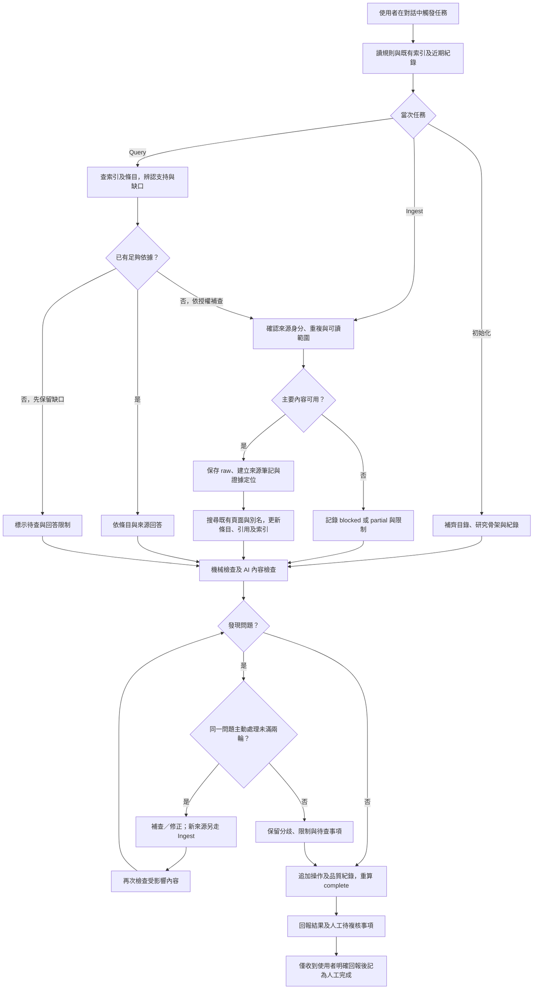
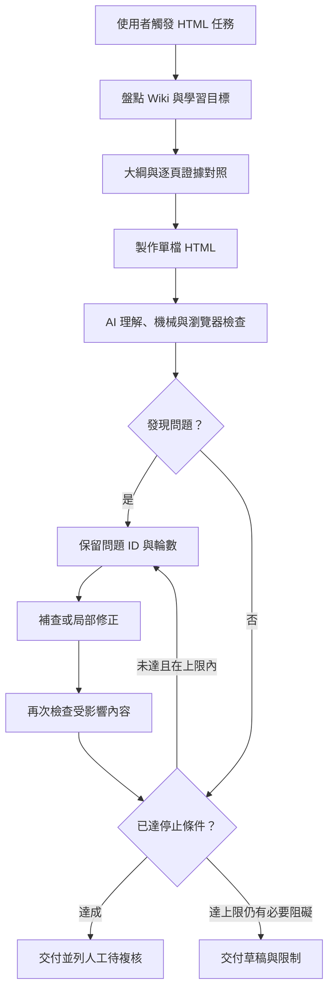
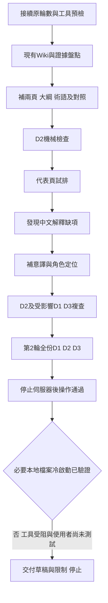

# Wiki 工作流程

更新日期：2026-11-16。本專案由使用者在對話中逐次觸發操作，Codex 依當次指令維護 Markdown；尚未部署排程、自動擷取或自動 ingest 系統。完整規則見 [AGENTS.md](AGENTS.md)。

## 初始化的實際執行（保留紀錄）

1. 讀取既有 AGENTS.md，以 `rg --files` 與目錄盤點確認專案只有此檔；README、索引與紀錄原本不存在。
2. 以網頁搜尋取得候選標題、網址與片段，列入[待查清單](logs/open_questions.md)；未開啟候選正文。
3. 建立基礎目錄、README、索引、歷史研究骨架及三份紀錄檔。
4. 執行基礎結構與內容邊界檢查，實際結果追加至[品質紀錄](logs/quality_report.md)。

初始化結束時 complete 來源數為 0；後續 ingest 已依新指示進行，見下節。工具能力與限制見 [README](README.md)。

## 2026-11-16｜首輪 Ingest 的實際執行

1. 讀取規則、README、索引、待查及近期紀錄，比對網址、標題、作者與 Boom bap 別名，確認沒有重複來源或既有實質曲風頁。
2. 讀取使用者提供的 [S001](wiki/sources/s001-in-search-of-boom-bap.md)主要正文；保存必要摘錄及本地定位，建立來源筆記與 [Boom bap](wiki/styles/boom-bap.md)，更新 overview 與 timeline。
3. 發現位元深度不能直接轉寫為規格，針對 Q08 補查一輪並採讀原設計者 [S002](wiki/sources/s002-roger-linn-mpc60.md)的完整相關問答，修正實質條目表述；其他搜尋片段未當作已讀證據。
4. 加入小型 [Python 檢查腳本](scripts/check_wiki.py)，用於重複核對新增引用錨點、索引、來源欄位與統計；另以 AI 檢查來源支持、年代限制及過度推論，將結果追加至品質紀錄。
5. 來源取得、條目更新、索引、操作與檢查條件滿足後列 complete；人工複核仍未執行。實際數量與結果以[品質紀錄](logs/quality_report.md)最新紀錄為準。

## 2026-11-16｜S003 的鏡像取得與 Ingest

1. 盤點既有來源與相關名稱，確認使用者提供的 GPB 文章未登錄，配置 S003。
2. GPB 帶參數網址逾時，移除參數後仍讀取失敗；停止重試，搜尋同篇可讀轉載。核對標題、作者、日期、可見段落及 NPR 來源標示，實讀 Wyoming Public Media 版本的主要正文與文末選曲清單。
3. 將 GPB 與轉載列為同一來源版本，保存讀取範圍、原頁阻礙及必要短摘。這是替代取得，不另計補查來源，也不宣稱 GPB 全文已成功讀取。
4. 建立 [Atlanta 地域歷史頁](wiki/history/atlanta-hip-hop.md)，更新總覽、時間軸及待查清單；保留作者觀點、上下文年份換算及單一來源的限制。
5. 沿用機械檢查腳本檢查結構，再由 AI 對照新主張的來源支持，記錄結果後列 complete。實際輪次與結案結果見[品質紀錄](logs/quality_report.md)。

本輪未新增其他獨立補查來源，未開設人物、作品、Trap 或 Rage 薄弱頁面。人工複核尚未執行，仍依對話逐次觸發。

## 2026-11-16｜S004 的商業概述與來源對照

1. 搜尋索引、網址、題名及名稱，確認不是既有來源或同篇轉載，配置 S004。帶追蹤參數網址無法讀取，無參數正文可讀，實讀全文主體與推廣結尾。
2. 保存必要短摘與本地定位，辨識機構署名、2024-08-16 日期及授權推廣目的，未把頁尾年份當更新日期。
3. 對照 S003 的製作人選例與 S004 的姓名／合作敘述；原文保存在 raw，Wiki 限縮製作歸屬與起源說法，不將差異強行選成唯一版本。
4. 為追溯兩段引語，開啟所連 NPR 原報導及一個同題轉載；分別受 robots、403 限制。搜尋片段未當全文，也未產生額外完成來源，問題保留於 Q16。
5. 建立 [Trap](wiki/styles/trap.md)，更新 Atlanta、overview、timeline、索引、來源關係與待查清單；沿用機械檢查及 AI 內容核對，再將來源與結案狀態記錄。詳見[品質紀錄](logs/quality_report.md)。

本輪以 SHA-256 比較既有 AGENTS.md 與三份 raw，內容均維持原貌；沒有拆新人物、作品、EDM 或 Rage 頁，也沒有部署自動研究服務。

## 2026-11-16｜S005、S006：平台評論與制度補查

1. 讀取規則、索引及近期紀錄，搜尋網址、題名、作者與 SoundCloud 別名，確認使用者提供的 Pitchfork 文章未入庫，配置 S005；帶參數及無參數版本不重複計數。
2. 讀取評論主要正文至結語，將作者的歷史選例、分期、當時觀察與預測分開處理；保存必要短摘與定位，不保存全文副本。
3. 因 RIAA 認證敘事需核對制度，補查官方原始資料；HTML 503 後讀到兩頁官方 PDF，配置 S006。確認歷史日期與公式，限定其不能證明榜單數字或單一藝人促成改革。
4. 建立 [SoundCloud 世代](wiki/history/soundcloud-generation.md)歷史頁，更新總覽、時間軸、Atlanta／Trap 導覽、索引及待查；沒有把平台世代建成固定曲風，也未建立通往 Rage 的未證實影響鏈。
5. 沿用機械檢查與 AI 內容核對，SHA-256 確認原 AGENTS.md 及四份 raw 共 5 檔不變；完成來源、索引及操作／檢查紀錄後結案。實際結果見[品質紀錄](logs/quality_report.md)。

完成來源共 6 份（4 份使用者資料、2 份自主技術／制度補查），已達至少五篇；人工複核與歷史待查仍另外記錄。沒有為達標重計 PDF／HTML、轉載或候選來源。

## 2026-11-16｜S007、S008：Rage 形成敘事與日期核對

1. 讀取既有規則、索引與紀錄，比對網址、題名、作者、Rage 及人物／作品別名，確認沒有重複來源或 Rage 實質頁；沿用既有 Wiki，配置 S007。
2. 讀完 HotNewHipHop 主要正文至展望，保存必要摘錄及本地定位；原發日未知、頁面更新日、正文資料截點及 RYM 轉引分開記錄。
3. 初輪檢索原發日、作品日期及製作訪談，未取得可採用的原發日或訪談正文；次輪針對平台目錄讀到 S008，補單曲日期。該日期只核作品資料，不證明唯一命名或聲音發明者。
4. 建立 [Rage](wiki/styles/rage.md)，更新總覽、時間軸與 Trap／SoundCloud／Atlanta 導覽，分開前驅、作品定型、名稱與推廣；保留原主張 ID，未拆薄弱人物或作品頁。
5. 執行既有機械檢查及 AI 內容核對，SHA-256 確認 AGENTS.md 與六份既有 raw 共 7 檔未變；依使用者「繼續」指示沿用中間成果完成索引、狀態及結案紀錄。結果見[品質紀錄](logs/quality_report.md)。

本輪兩份來源完成後共 8 份（5 份使用者資料、3 份自主補查）；沒有將平台其他版本、搜尋片段或未讀 RYM 原頁另計。作品日期問題已做兩輪檢索，未解部分保存限制，沒有無限補查。

## 2026-11-16｜S009：藝人評論與既有條目的整合

1. 讀規則、README、索引、待查與近期紀錄，比對網址、題名、作者及相關別名，確認不是既有八份來源的版本，配置 S009。
2. KNKX 參數版 cache miss 後，無參數版成功；讀完 NPR 署名評論主要正文至結語。搜尋到的同篇公媒轉載不另計，也未當成額外全文閱讀。
3. 保存必要短摘與本地定位；以現有 Rage、SoundCloud、總覽吸收人聲／分類及不同時點的比較。時間軸只補事件區分筆記，沒有把文章日期當作品日期或猜填預告日期。
4. 將新增評論與原始發行、製作、平台機制等證據分開，保留命名與直接影響限制；沒有為補齊段落而新增人物或作品頁，也未新增自主補查來源。
5. 沿用機械檢查、AI 內容核對與既有規則／raw 的 SHA-256 比對；實際完成狀態與結果以[品質紀錄](logs/quality_report.md)及來源筆記登錄為準。

這是對話觸發的單次 ingest，沒有新增多代理、排程或背景服務。

S009 已滿足完成條件，complete 共 9 份（6 份使用者資料、3 份自主補查）；機械與 AI 檢查已執行，人工複核及歷史缺口另外保留。AGENTS.md 與八份既有 raw 共 9 檔的 SHA-256 前後一致。

## 角色與紀錄

| 角色 | 責任 |
| --- | --- |
| 使用者 | 決定當次範圍、提供來源或修正方向，並明確回報人工複核結果 |
| Codex | 依授權盤點、查讀、建頁、維護引用、執行機械及 AI 內容檢查、追加紀錄 |
| 命令與網頁工具 | 協助搜尋、取得可讀內容與檢查結構；工具成功不代表歷史主張已證實 |

目前由單一 Codex 執行，未建立多代理分工或背景服務。

## Ingest 與 Query 的作法

每次開始先讀 AGENTS、README、索引、待查清單及近期操作紀錄。ingest 以一份來源為基本單位：比對身分與重複版本，確認實際可讀範圍，配置穩定 ID，保存 raw，建立包含必要欄位的來源筆記，再搜尋既有條目及別名並更新有證據支持的內容。單次可逐份處理多來源，最後做跨來源檢查。

來源筆記依 AGENTS 記錄作者、日期、原始及實際讀取網址、取得日期、類型、使用者提供或補查原因、raw 連結、讀取範圍、主張定位、限制、相關頁面、ingest 與檢查狀態。未知欄位明確標示未知；原始資料更新時另存版本。

Query 先查索引與相關條目，只根據 Wiki 中的支持作答；有缺口時可依當次授權補查，先完成入庫再用於正式結論。跨條目的分析可寫回 history 並標為綜合解讀，問答本身不算獨立來源。

## 處理流程 graph

下圖描述工作步驟，不是已部署的程式或背景自動化。

## Check 的界線

- 機械檢查：本地連結與檔案、索引覆蓋、必要欄位、來源 ID 唯一性、重複來源線索與 complete 統計。命令只能證明實際檢查到的結構。
- AI 內容檢查：引用是否支持主張、日期與分類是否一致、是否保留分歧、是否過度推論因果及有哪些研究缺口。
- 人工複核：另列具體問題；只有收到使用者明確回報，才記錄為使用者已複核。

同一問題最多主動補查／修正兩輪；仍未解決就保存限制並繼續其他工作。新證據出現後可再處理。補查來源需留下原因、所解問題與實際影響頁面。遠端連結無法存取與證據內容錯誤分別記錄。

## 頁面連結的知識 graph

知識 graph 是 Wiki 頁面與有說明的關係所形成的網絡，與上方處理流程不同。日後的重要歷史關係需區分直接影響、共享背景、風格比較、時間先後與研究假說，並附主張及來源。

目前[索引](wiki/index.md)連到總覽、時間軸、Boom bap、Atlanta、Trap、SoundCloud 世代、Rage 及來源筆記；實質主張連到來源 E 段落，再連到 raw 的 P 區塊及原始／實讀網址。這是引用與比較網絡；合作、平台、作品名或時間先後不會自動形成風格影響鏈。超連結本身不構成影響證據。

## 完成與交付

只有來源主要內容足夠、來源筆記及至少一個實質條目已更新、索引與操作紀錄已更新且有檢查結果，才計為 complete；片段、轉載與格式版本不另充篇數。ingest 狀態及檢查狀態分開記錄。

每次回報新增或更新檔案、實際讀取來源、檢查結果、complete 獨立來源總數、是否達到五篇，以及待查事項、工具限制與下一步。操作與品質紀錄採追加式保存。

## 2026-11-16｜HTML 簡報 Loop 規格已建立，尚未執行

依使用者要求建立 [presentation-loop.md](presentation-loop.md)，定義「從 Boom Bap 到 Rage」HTML 簡報的學習目標、逐頁證據對照、新手檢核、瀏覽器檢查、分類修正與停止條件。這是待觸發的任務規格，不是已執行的簡報製作紀錄；本次未建立 HTML 或簡報產物目錄，也未重新讀取外部歷史來源。後續收到製作指令，再依該文件接續現有 Wiki，保留研究與簡報的問題紀錄。

## 2026-11-16｜HTML 簡報任務的實際執行

收到使用者製作指令後才啟動 [presentation-loop](presentation-loop.md)，沿用現有 Wiki；由同一 Codex 依序執行盤點、編排、撰寫、AI 審閱、修正與複查。沒有獨立審稿人、多代理、排程或背景研究服務。

1. 實讀主線條目、相關來源筆記及 raw，重開 S001／S004／S007；發現基本詞義缺口，補讀原廠 [S010](wiki/sources/s010-roland-synthesizer-terms.md)，先更新 Boom bap C05、Rage C07，再用於簡報。跨條目框架先寫回 overview C07。
2. 建立 [13 頁 HTML](presentations/boom-bap-to-rage/index.html)、[大綱](presentations/boom-bap-to-rage/outline.md)、[33 項證據對照](presentations/boom-bap-to-rage/evidence-map.md)及[review log](presentations/boom-bap-to-rage/review-log.md)。簡報來源詳情內嵌，無外部字體或 CDN。
3. 執行 1 輪完整 D1–D3，實際以 1366×768 與 1920×1080 viewport 逐頁檢視，檢查旁註與導覽。發現四頁超高、支線術語及對照漏列，修正後先複查受影響頁面。Boom bap 頁的同一版面問題用了兩次局部修正，沒有重設輪數或無限重跑。
4. 檢查原始資料未被改寫、Wiki／HTML 結構及來源數後交付；停止暫時預覽程序。標記「AI 檢查完成，待使用者複核」，不把 AI 新手檢核寫成真人學習測試。

以下為本次 HTML 處理流程 graph，不是 Wiki 知識關係或已部署的自動化：

file 協定被瀏覽器工具政策禁止，沒有繞過；本機 HTTP 逐頁及載入後無伺服器互動已驗證，直接檔案冷啟動、實體投影、列印與錄音聆聽未驗證。詳細分項及停止依據保留於 review log。S010 完成後 complete 共 10 份（6 份使用者資料、4 份補查），達五篇門檻；既有歷史問題不因此結案。

## 2026-11-17｜依首輪問題修訂簡報規格，未重新製作

依使用者指示調整 [presentation-loop.md](presentation-loop.md)：開始前實測預覽方式與視窗尺寸，大綱先補術語／人物說明，少量代表頁先試排；每批相關修改完成後先做適用的機械檢查，再查內容與畫面，修正後只複查受影響範圍。完整檢查最多三輪、同題主動處理最多兩輪均保留；預檢及試排的問題也計入同題上限。

新版將 HTTP 啟動、本地檔案冷啟動與載入後無伺服器互動分開驗收，必要情境未驗證時交付草稿／部分完成。更新後的處理流程 graph 位於該規格第 9 節；上方 2026-11-16 graph 保留為當時的實際工作紀錄，不回寫成新版已執行。

本次只讀取專案文件、首輪簡報問題與檢查腳本，修訂規格及同步入口／操作紀錄；沒有重新讀取外部研究來源、製作 HTML、操作瀏覽器或重跑簡報 D1–D3。complete 獨立來源仍為 10 / 5，人工複核與原有未驗證事項保持原狀。

## 2026-11-17｜依新版流程接續15頁HTML

收到使用者繼續補全的指令後，由同一Codex依序執行，沿用1輪完整檢查與P001–P006的累計輪數，沒有多代理或背景排程。

1. 先讀專案文件及既有產物；HTTP實際載入預檢通過，本地檔案冷啟動沿用政策受阻，仍列單檔交付的必驗情境。
2. 重讀現有主線Wiki、採用八份來源的本地筆記與raw。以S003／Atlanta C03補Outkast頒獎事件，以S009／Rage C06及overview C06補Carti人聲；沒有新增研究來源或擴大已達上限的補查。
3. 在原HTML新增穩定ID 14／15，保留原13個ID，按敘事插入；[大綱](presentations/boom-bap-to-rage/outline.md)補7列術語及提前L01–L04檢核，[證據對照](presentations/boom-bap-to-rage/evidence-map.md)增至36項。
4. 先做D2，再試排新增兩頁及比較表。發現英文發言缺中文，補意譯及評論者定位；再D2，複查受影響的內容與畫面。1920截圖受限，改用實際1600×900作較大比例驗證，未把數值代成全份目視。
5. 完成第2輪可執行的全份D1–D3：1366×768與1600×900各目視15頁，驗證插頁、按鈕、鍵盤、邊界及八份來源。停止伺服器後再驗證已載入頁面的slide-15／S009互動，重設viewport並關閉預覽。
6. 使用者回覆「尚未測試，先完成其他檢查」，不再詢問或冒稱人工完成。依新版必要情境規則，交付[15頁HTML](presentations/boom-bap-to-rage/index.html)為**草稿／部分完成**，具體紀錄見[review log](presentations/boom-bap-to-rage/review-log.md)。可做工作完成後停止，不為湊滿3輪重跑。

本次實際處理流程如下；與Wiki頁面連結形成的知識graph分開。

complete來源仍為10 / 5，raw、來源頁及歷史條目未改；新規格文件本身亦未再次修改。先前的規格修訂、首版完成紀錄維持其當時狀態，新版驗收結論以本節及本次review log為準。
